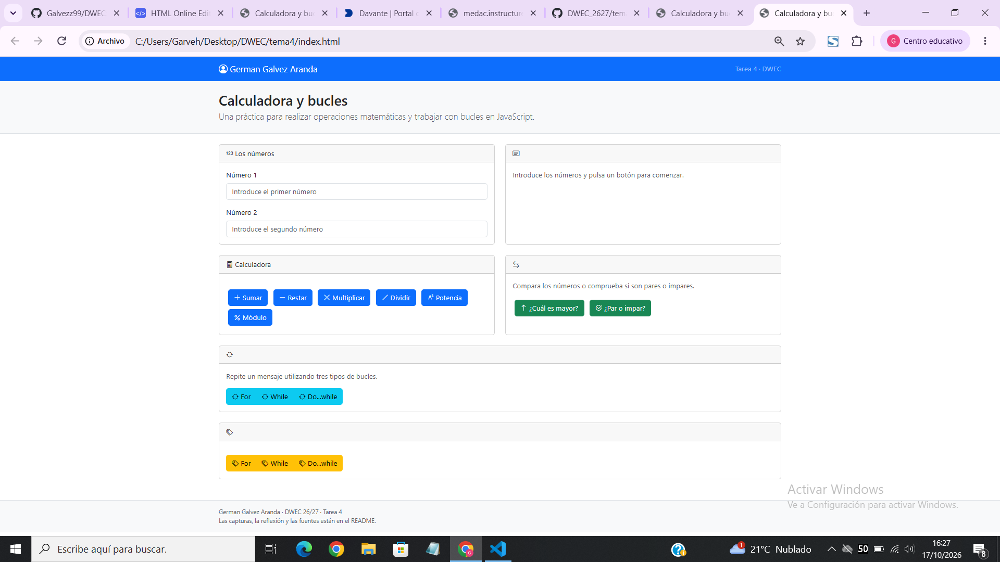
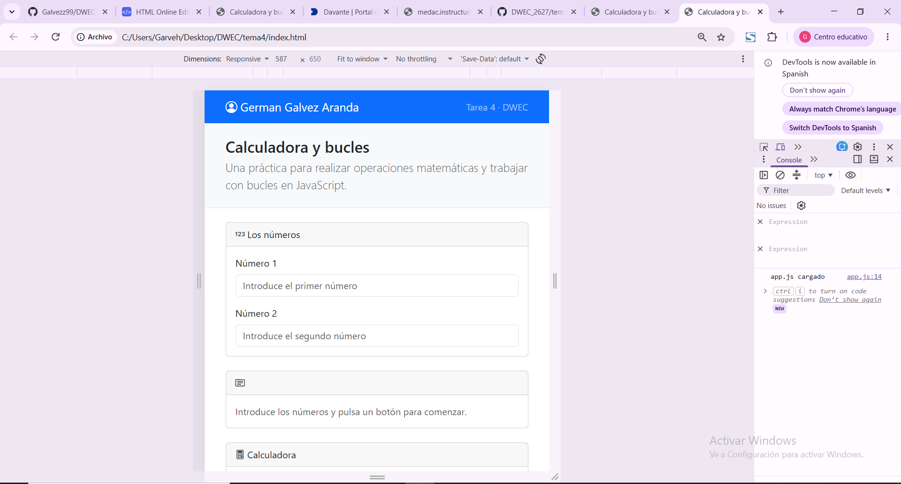
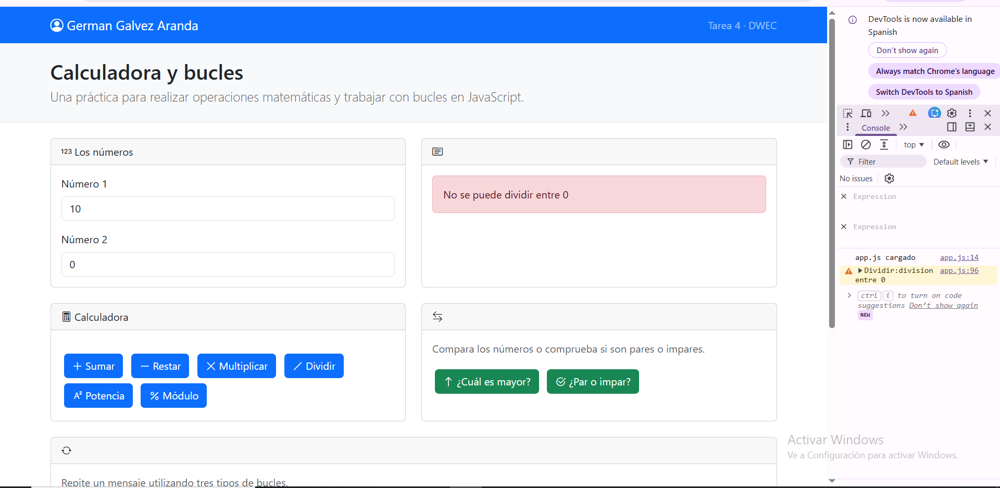
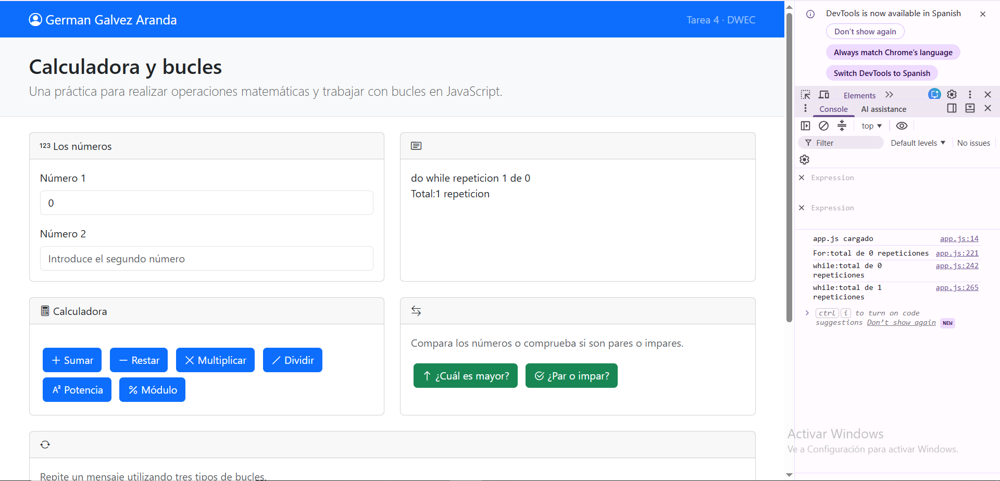
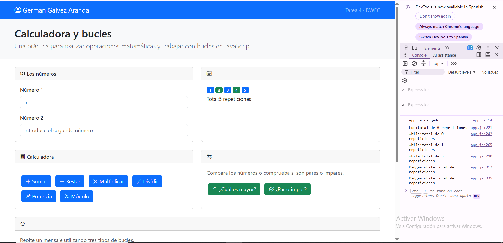

# Tarea 4 · Calculadora y bucles
# Autor: Germán Gálvez Aranda · Desarrollo Web en Entorno Cliente (DWEC) · 2.º DAW · Curso 2026-27

Capturas
a) La página entera
La página entera con mi nombre en la navbar

b) La página en el móvil
La página en el modo móvil de las herramientas de desarrollo

c) El error de dividir entre 0
El error de dividir entre 0 con la consola abierta

d) Los tres bucles con el número 0
Los tres bucles de texto con el número 0 y la consola abierta

e) Un bucle con badges
Un bucle con badges

Reflexión
[De 5 a 8 líneas: ¿en qué se diferencian for, while y do…while y cuándo usarías cada uno? Pon como ejemplo lo que pasó con el 0.]

* El bucle for se usa cuando sabes cuántas veces quieres repetir algo

* El while se usa mientras una condicion sea verdadera y comprueba esa condición de cada vuelta

* El do while comprueba una condición al final,ejecuta el bloque al menos una vez.

Fuentes
* (https://github.com/devMarDav/Solucion-JavaScript-Mario/blob/main/js/ejercicio12.js)

* https://developer.mozilla.org/es/docs/Web/JavaScript/Guide/Expressions_and_operators

* https://developer.mozilla.org/es/docs/Web/JavaScript/Guide/Loops_and_iteration

Uso de IA

* He usado ChatGPT para resolver dudas sobre JavaScript y ver ejemplos de operaciones, condiciones y bucles. Después adapté las explicaciones a mi código, probé las funciones en el navegador y revisé los errores que fueron apareciendo.