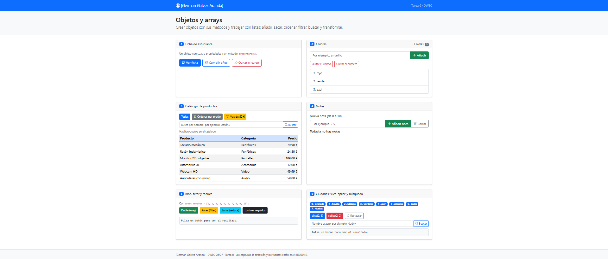
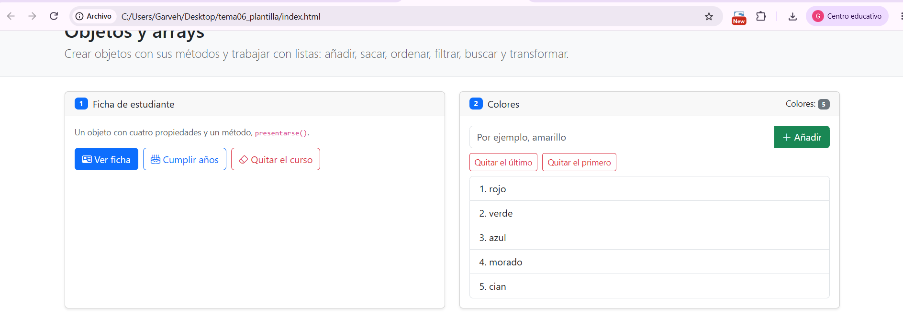
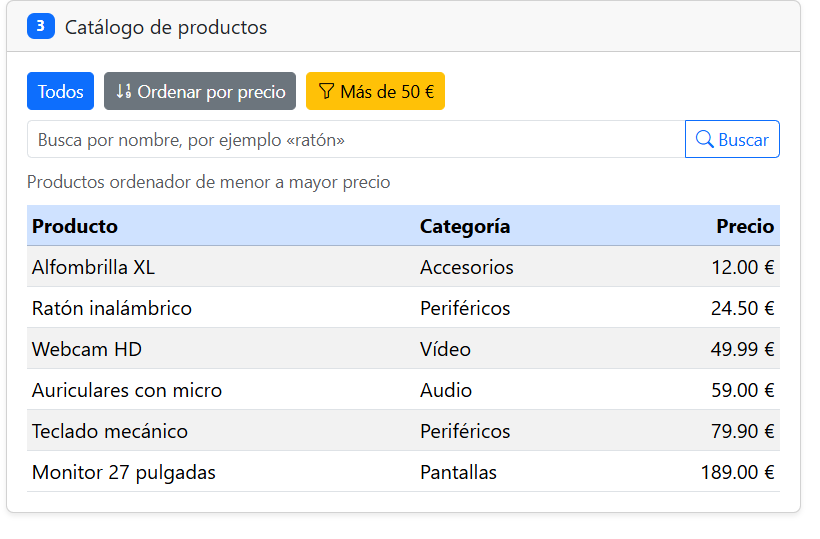
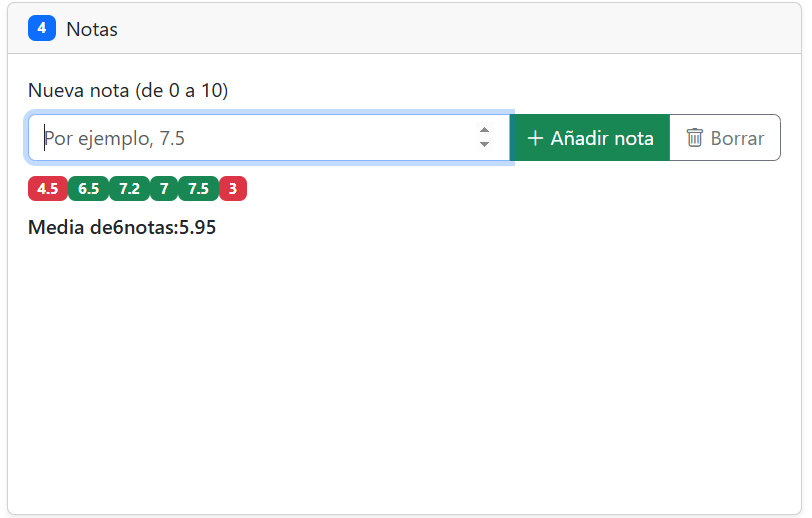
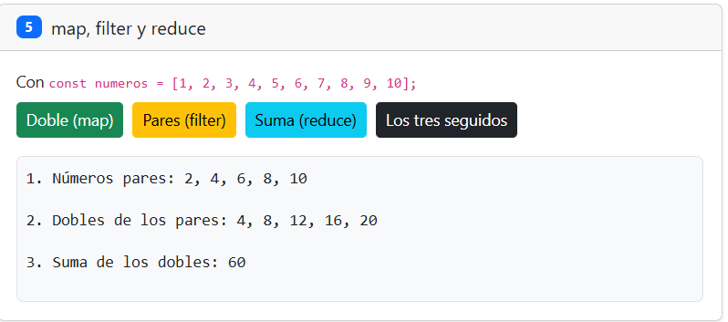
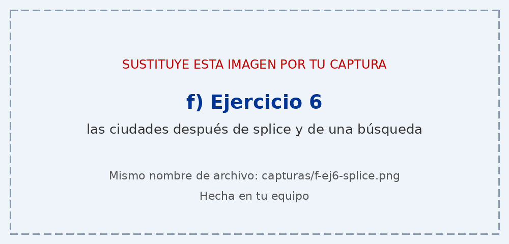

# Tarea 6 · Objetos y arrays

**Autor:** German Galvez Aranda · Desarrollo Web en Entorno Cliente (DWEC) · 2.º DAW · Curso 2026-27

### a) La página recién cargada

Se ve la cabecera de la tarea y las seis tarjetas. Al cargar, aparecen los colores iniciales, los seis productos del catálogo y la lista de ciudades.

### b) Ejercicios 1 y 2: la ficha y los colores

La ficha representa al estudiante mediante un objeto con nombre, apellidos, edad y curso. Sus botones permiten mostrar los datos, aumentar la edad y quitar la propiedad del curso. En la lista de colores, `push()` añade un color al final, `pop()` quita el último y `shift()` quita el primero.

### c) Ejercicio 3: el catálogo ordenado por precio

![Catálogo de productos ordenado por precio]

El catálogo contiene seis productos con nombre, categoría y precio. Para ordenarlos de menor a mayor, la función de comparación resta `a.precio - b.precio`. Antes de llamar a `sort()`, se crea una copia con `[...productos]`, porque `sort()` modifica el array sobre el que se ejecuta y así se conserva el catálogo original.

### d) Ejercicio 4: las notas y la media

![Notas con su color y la media]

Se pueden añadir notas entre 0 y 10. Las notas de 5 o más se muestran en verde y las inferiores a 5, en rojo. La media se calcula sumando las notas con `reduce()` y dividiendo el total entre el número de notas.

### e) Ejercicio 5: los tres métodos seguidos

![Resultado de filter, map y reduce encadenados]

Partiendo de los números del 1 al 10, `filter()` selecciona los pares (2, 4, 6, 8 y 10), `map()` duplica cada uno (4, 8, 12, 16 y 20) y `reduce()` suma los resultados. La suma final es **60**.

### f) Ejercicio 6: después de splice y de buscar una ciudad

`splice(2, 2)` elimina dos elementos desde el índice 2: Málaga y Córdoba. Después, Jaén queda en el índice 2 (los arrays empiezan en el índice 0). La búsqueda comprueba si el nombre exacto está en el array y muestra su posición; si no existe, `indexOf()` devuelve `-1`.

## Reflexión

Los métodos `push()`, `pop()` y `shift()` cambian el array de colores original al añadir o quitar elementos.
`sort()` también modifica el array sobre el que trabaja; por eso, en el ejercicio 3 primero ordeno una copia de `productos`.
En el ejercicio 6, `slice(2, 5)` devuelve una sección nueva y deja intacto el array de ciudades.
En cambio, `splice(2, 2)` elimina elementos del propio array y devuelve los elementos que ha quitado.
`map()` y `filter()` crean arrays nuevos, mientras que `reduce()` devuelve un único resultado, como la suma o la media.
Esta diferencia permite elegir entre conservar los datos iniciales o modificarlos según lo que necesite cada operación.

## Fuentes

- [Array — JavaScript | MDN](https://developer.mozilla.org/es/docs/Web/JavaScript/Reference/Global_Objects/Array): métodos de arrays y cuáles modifican el array original.
- [Get started with Bootstrap 5.3](https://getbootstrap.com/docs/5.3/getting-started/introduction/): inclusión de Bootstrap mediante CDN.

