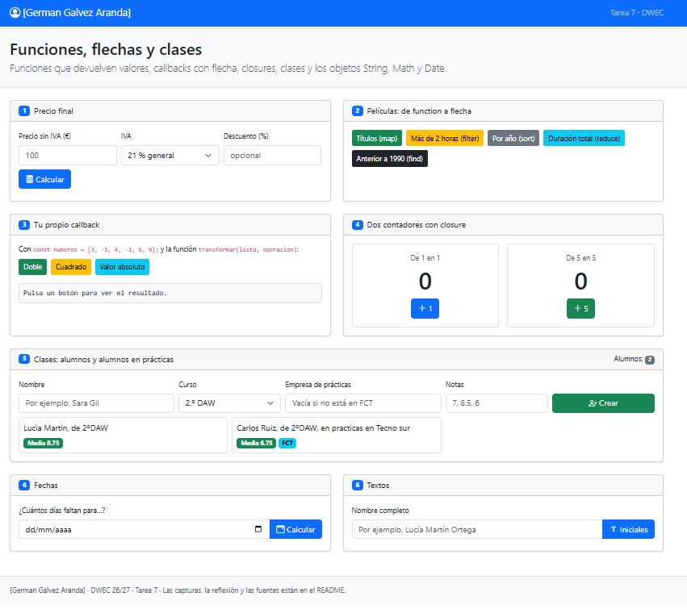
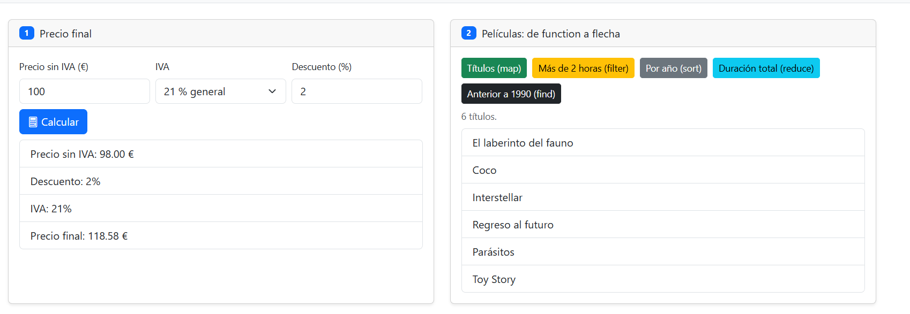
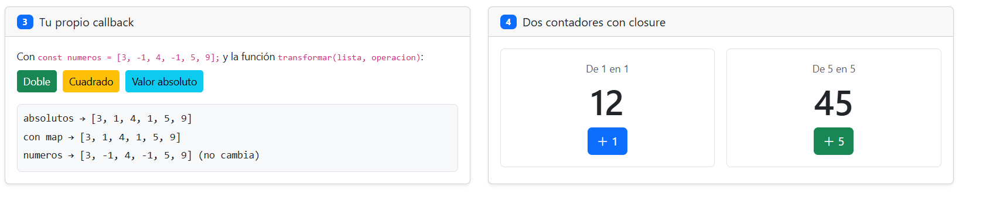
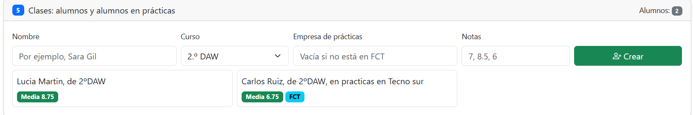
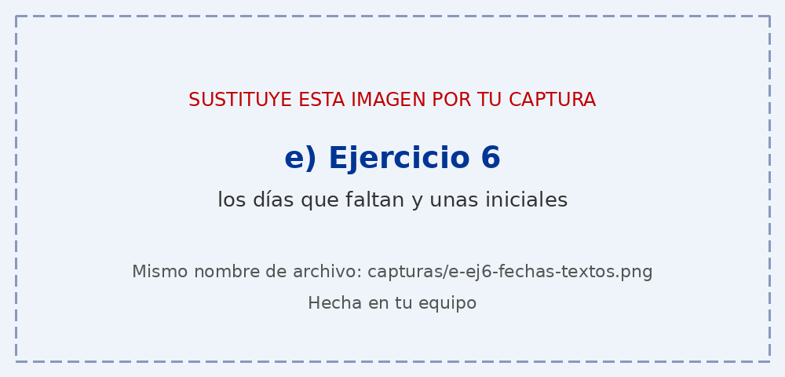

# Tarea 7 · Funciones, flechas y clases

**Autor:** [German Galvez Aranda] · Desarrollo Web en Entorno Cliente (DWEC) · 2.º DAW · Curso 2026-27

> **Plantilla de la tarea 7.** Cómo usarla:
>
> 1. Copia esta carpeta en tu repositorio de DWEC y cámbiale el nombre a `tema07`.
> 2. `index.html` ya está maquetado: una card por ejercicio (el 6 tiene dos). No cambies los `id` ni el `onclick` de los botones.
> 3. `js/app.js` trae una función por botón con `TODO`. Ya están hechas `pintarLista()`, `formatearEuros()`, `pintarAlumnos()` y un modelo en los ejercicios 3, 4 y 6.
> 4. Flechas en todos los callbacks y nunca una flecha como método. Las funciones de los botones, con `function`.
> 5. Sustituye las imágenes de `capturas/` por las tuyas, **con el mismo nombre**.
> 6. Todo lo que va entre [corchetes] es un hueco: cámbialo por lo tuyo. Al terminar, borra este aviso.

[Una o dos líneas: qué hay en esta carpeta y cómo se ve. Por ejemplo: abrir la carpeta en VS Code, pulsar **Go Live** y probar los botones con la consola abierta (F12).]

## Capturas

### a) La página recién cargada

Se observa la página recién cargada con mi nombre en la barra de navegación y el pie de página con los diferentes ejercicios a mostrar

### b) Ejercicios 1 y 2: el precio y las películas

Se muestra el cálculo de un precio con una base de 100, un IVA del 21% y un descuento del 10%, dando un precio final de 94.50 €. La función `calcularPrecio()` realiza solo la lógica matemática con parámetros por defecto, mientras que `mostrarPrecio()` se encarga de leer el DOM, validar los datos y pintar el resultado. A la derecha, se ve el listado de películas filtradas por duración usando un callback con flecha

### c) Ejercicios 3 y 4: tu callback y los contadores

![El resultado de transformar y los dos contadores]

[Qué hace transformar() por dentro y por qué cada contador lleva su propia cuenta.]

### d) Ejercicio 5: los alumnos

![Las tarjetas de los alumnos]

[Al menos cuatro alumnos, alguno en prácticas. Cómo decide tu código si crea un Alumno o un AlumnoFCT.]

### e) Ejercicio 6: fechas y textos

[Qué fecha has probado, cuántos días salen y por qué redondeas.]

## Reflexión

Cuando cambiamos un function por una función flecha, el código queda más corto y sencillo de leer. Además, las flechas utilizan el this del contexto en el que se encuentran. En cuanto al return, no hace falta escribirlo cuando la función tiene una sola expresión y no usamos llaves {}. Por ejemplo, en p => p.anio < 1990, el resultado se devuelve directamente.

## Fuentes

-https://developer.mozilla.org/es/docs/Web/JavaScript/Reference/Functions/Arrow_functions?

-https://es.javascript.info/

https://developer.mozilla.org/es/docs/Web/JavaScript/Reference/Global_Objects/Array?

## Uso de IA

[Si has usado IA: qué herramienta, para qué y qué hiciste después con su respuesta. Si no la has usado, borra este apartado.]
