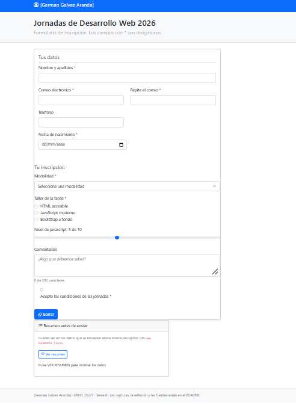
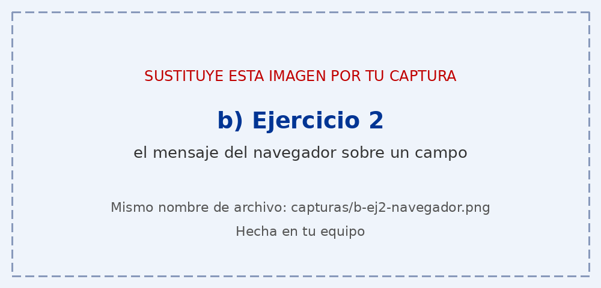
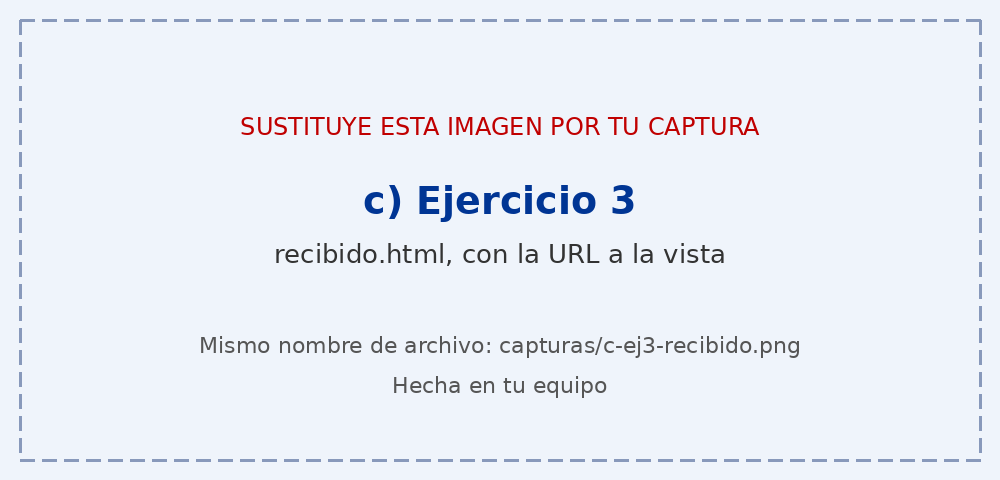
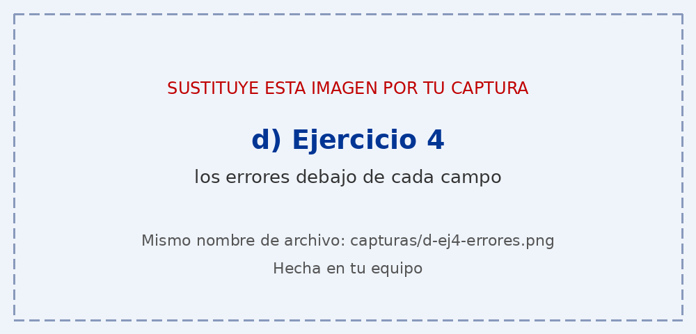
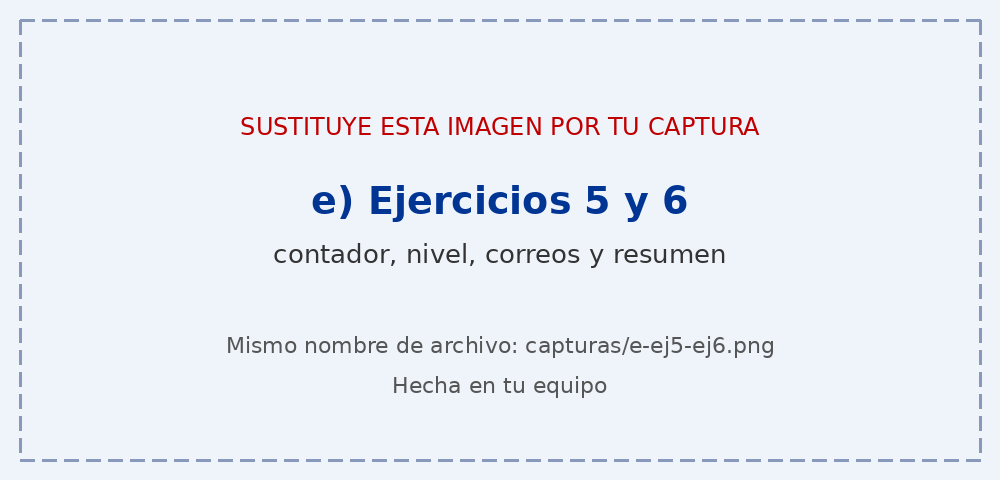

# Tarea 8 · Formulario de inscripción

**Autor:** Germán Gálvez Aranda · Desarrollo Web en Entorno Cliente (DWEC) · 2.º DAW · Curso 2026-27

## Descripción

En esta carpeta se encuentra el formulario de inscripción a las Jornadas de Desarrollo Web 2026.

El proyecto está formado por `index.html`, donde está el formulario; `recibido.html`, donde se muestran los datos enviados; y los archivos JavaScript `app.js` y `recibido.js`.

Para probarlo, hay que abrir el proyecto en Visual Studio Code y utilizar Live Server. También se puede abrir la consola del navegador con F12 para comprobar los mensajes.

## Capturas

### a) La página recién cargada

En esta captura se muestra el formulario completo con mi nombre en la barra de navegación y los campos organizados en dos apartados: Tus datos y Tu inscripción.

### b) Ejercicio 2: el mensaje del navegador

En esta captura se muestra un mensaje del navegador al intentar enviar un campo obligatorio vacío o con un formato incorrecto. También se ha probado a quitar un atributo `required` desde F12. Esto demuestra que la validación del navegador se puede modificar, por lo que el servidor también debe comprobar los datos.

### c) Ejercicio 3: lo que llega por GET

En esta captura se muestran los datos enviados mediante GET, que aparecen en la dirección URL y posteriormente en una tabla de la página `recibido.html`.

El campo de repetir el correo no llega porque no tiene atributo `name`. Nunca enviaría una contraseña mediante GET porque aparecería en la URL y podría quedar guardada en el historial del navegador.

### d) Ejercicio 4: los errores junto a cada campo

En esta captura se muestran varios errores de validación junto a sus respectivos campos. Los mensajes aparecen debajo de los campos para indicar qué se debe corregir.

### e) Ejercicios 5 y 6: eventos y resumen

En esta captura se muestra el contador de caracteres de los comentarios, el nivel de JavaScript, la comprobación de los dos correos y el resumen de los datos del formulario mediante FormData.

## Reflexión

La validación con JavaScript permite personalizar los mensajes de error y mostrarlos junto a cada campo, haciendo que el formulario sea más fácil de utilizar.

La validación del navegador también ayuda, pero no es suficiente porque se puede modificar desde las herramientas del desarrollador.

Por eso, el servidor siempre tiene que comprobar los datos antes de utilizarlos.

Cuando utilizamos una función flecha para el evento submit, `this` no representa al formulario, sino que mantiene el contexto exterior.

Por eso utilizamos `e.target` para acceder al formulario que ha enviado los datos.

## Fuentes

- [MDN - Validación de formularios](https://developer.mozilla.org/es/docs/Learn_web_development/Extensions/Forms/Form_validation)
- [MDN - URLSearchParams](https://developer.mozilla.org/es/docs/Web/API/URLSearchParams)
- [MDN - FormData](https://developer.mozilla.org/es/docs/Web/API/FormData)

## Uso de IA

Se ha utilizado ChatGPT como ayuda para entender algunos apartados de la tarea, revisar el código JavaScript y resolver dudas durante el desarrollo.

Después se ha revisado y probado el código para comprobar su funcionamiento y entender lo que hace cada parte.